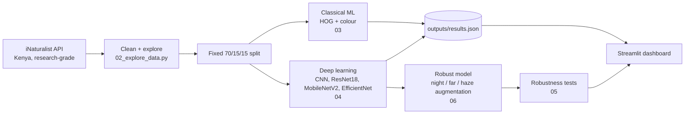

# 🦁 Kenyan Wildlife Spotter

Deep learning that names the animal in a photo from Kenya's national parks, tested on eight species and stress-tested for **night, camera-trap infrared, distant animals, dusty haze and different habitats**. Comes with an interactive Streamlit dashboard.

**Author:** Halima Mahdi Mohammed (ID 670315) · BSc Data Science and Analytics, USIU-Africa · DSA 4050 Term Project

---

## Contents
1. [Results at a glance](#results-at-a-glance)
2. [How it works](#how-it-works)
3. [Project structure](#project-structure)
4. [Quick start](#quick-start)
5. [Training on Google Colab (recommended)](#training-on-google-colab-recommended)
6. [Night, distance and surroundings](#night-distance-and-surroundings)
7. [The dashboard](#the-dashboard)
8. [Troubleshooting](#troubleshooting)
9. [Limitations and ethics](#limitations-and-ethics)
10. [Data credits and references](#data-credits-and-references)

---

## Results at a glance

Test accuracy on the same unseen photos for every model (8 species, 15% test split):

| Model | Family | Test accuracy | Macro-F1 |
|---|---|---|---|
| **MobileNetV2** | Deep learning (transfer) | **92.95%** | 0.930 |
| ResNet18 | Deep learning (transfer) | 92.28% | 0.923 |
| EfficientNet-B0 | Deep learning (transfer) | 91.95% | 0.920 |
| Simple CNN (from scratch) | Deep learning | 50.00% | 0.499 |
| Random Forest | Classical ML | 41.61% | 0.403 |
| SVM (RBF) | Classical ML | 41.61% | 0.409 |
| Logistic Regression | Classical ML | 31.88% | 0.322 |
| k-NN (k=5) | Classical ML | 26.17% | 0.256 |

- Pretrained deep networks beat the best classical model by about 51 points. Random guessing would score about 12.5%.
- The three pretrained networks are within about 1 point of each other, so the choice between them is about size and speed. MobileNetV2 is the lightest.
- These numbers come from `outputs/results.json`. If you retrain, they will change slightly, so re-check this table.

The robustness results (night, distance, haze, regions) are produced by `src/05_robustness_eval.py` and saved to `outputs/robustness.json`. They are not listed here until you have run it.

---

## How it works



1. **Data mining:** verified Kenyan sightings of 8 species (elephant, lion, giraffe, zebra, buffalo, cheetah, hippo, wildebeest) with GPS and date, from the open iNaturalist API.
2. **Baselines:** classical machine learning on hand-crafted features (HOG shape + colour histograms).
3. **Deep learning:** a small CNN from scratch and three ImageNet-pretrained networks fine-tuned in two stages (classifier first, then the whole network).
4. **Robustness:** the models are re-scored under simulated night, infrared, far-away and haze conditions, and per Kenyan region. A robust model is retrained with those conditions as data augmentation.
5. **Dashboard:** explore the data, compare models, identify a photo and stress-test it.

---

## Project structure

```
wildlife-spotting/
├── src/
│   ├── config.py                  settings: species list, paths, image size
│   ├── 01_fetch_inaturalist.py    mine photos + GPS from iNaturalist
│   ├── 01b_fetch_kaggle_alternative.py   backup dataset (no GPS)
│   ├── 02_explore_data.py         clean data, charts
│   ├── 03_train_classical.py      LogReg, SVM, Random Forest, k-NN
│   ├── 04_train_deep.py           CNN, ResNet18, MobileNetV2, EfficientNet-B0
│   ├── 05_robustness_eval.py      accuracy per condition and per region
│   ├── 06_train_robust.py         retrain with night/far/haze augmentation (+ unseen-region test)
│   ├── robustness.py              the simulated conditions (PIL + numpy only)
│   ├── regions.py                 GPS -> Kenyan region
│   ├── robust_data.py             helpers shared by steps 5 and 6
│   ├── data.py, results_io.py     split + results helpers
├── dashboard/app.py               Streamlit dashboard (6 tabs)
├── report/build_report.py         builds the Word write-up from your real results
├── run_all.py                     runs the pipeline in order
├── requirements.txt
├── data/        (raw photos and CSVs, not in Git)
├── models/      (trained weights, not in Git)
└── outputs/     (charts and JSON results, not in Git)
```

---

## Quick start

You need Python 3.10 to 3.12. Run these from the project folder.

**Windows (PowerShell)**
```powershell
python -m venv .venv
Set-ExecutionPolicy -Scope Process -ExecutionPolicy Bypass
.venv\Scripts\activate
python -m pip install -r requirements.txt
```

**Mac or Linux**
```bash
python3 -m venv .venv
source .venv/bin/activate
python -m pip install -r requirements.txt
```

**Run everything** (about 30 to 60 minutes on CPU, minutes on a GPU):
```bash
python run_all.py --robust
```
or step by step:
```bash
python src/01_fetch_inaturalist.py --per-species 250   # mine ~2,000 photos
python src/02_explore_data.py                          # clean + charts
python src/03_train_classical.py                       # baselines
python src/04_train_deep.py                            # deep models
python src/06_train_robust.py                          # robust MobileNetV2
python src/05_robustness_eval.py                       # baseline vs robust, per condition and region
python -m streamlit run dashboard/app.py               # dashboard
python report/build_report.py                          # Word write-up
```
Use `--quick` on `run_all.py`, `04` or `06` for a fast trial first.

---

## Training on Google Colab (recommended)

Colab gives a free GPU (deep models train in about 2.5 minutes each) and avoids local install problems. The dashboard then runs on your own computer.

1. **Runtime → Change runtime type → T4 GPU.**
2. Paste each block into its own cell:

```python
# 1. Clone and install
!git clone https://github.com/halima-04/Wildlife-Spotter.git
%cd Wildlife-Spotter
!pip install -q scikit-image plotly tqdm python-docx
```
```python
# 2. Mine and explore the data (10-20 min)
!python src/01_fetch_inaturalist.py --per-species 250
!python src/02_explore_data.py
```
```python
# 3. Baselines and deep models
!python src/03_train_classical.py
!python src/04_train_deep.py
```
```python
# 4. Robust model and robustness tests
!python src/06_train_robust.py
!python src/05_robustness_eval.py
```
```python
# 5. Optional: does it cope with an area it has never seen?
!python src/06_train_robust.py --holdout-region "Maasai Mara"
```
```python
# 6. Zip the results and download
!zip -r results.zip data/metadata.csv data/splits.csv models/classes.json outputs $(ls models/*.pt | grep -v best_model.pt)
from google.colab import files
files.download("results.zip")
```

3. Extract `results.zip` **into your project folder** (merge and replace `data/`, `models/`, `outputs/`), then run the dashboard.

Colab deletes its files when the session ends, so download the zip before closing the tab.

---

## Night, distance and surroundings

Real animals are not always big, bright and in daylight. The project handles this in three ways.

| Challenge | What the project does |
|---|---|
| **Night** | Simulated low light (dark, blue cast, noise) and **infrared camera-trap** images (greyscale, bright centre, grain). |
| **Far away** | Simulated distance by shrinking the animal to 40%, 22% or less of the frame, with natural-looking surroundings. A **scan mode** in the dashboard slides windows over the image to find small animals. |
| **Different surroundings** | Dust haze and golden-hour lighting are simulated. Sightings are grouped into Kenyan regions (Maasai Mara, Nakuru-Naivasha, Nairobi NP, Amboseli, Tsavo, Laikipia-Samburu) from their GPS, and accuracy is reported per region. The `--holdout-region` test trains without one region and tests on it. |

How to use it:
- `05_robustness_eval.py` tests models on the **same** test photos under 8 conditions and writes `outputs/robustness.json`, `robustness.png` and `stress_examples.png`.
- `06_train_robust.py` retrains MobileNetV2 with these conditions as augmentation (60% of training images, new random draw every epoch). Validation uses a fixed mix of conditions, so the saved weights are the best across conditions, not just on clean photos.
- The dashboard's **Stress test** tab lets you apply night, distance and haze to any photo with sliders and compare the baseline and robust models side by side.

**Be honest about this in your report:** the conditions are simulations. They show the trend and train robustness, but they are not real night photographs. Real camera-trap datasets such as Snapshot Serengeti on LILA BC contain true night and distant images and are the natural next step.

---

## The dashboard

```bash
python -m streamlit run dashboard/app.py
```

| Tab | What it shows |
|---|---|
| 📊 Overview | Key numbers, class balance |
| 🗺️ Sightings map | Verified Kenyan sightings, filter by species, sightings by month |
| 🖼️ Species explorer | Sample photos per species (needs `data/raw` on your computer) |
| 🏆 Model comparison | Accuracy bars, learning curves, confusion matrices |
| 🔍 Spot an animal | Upload a photo, see the species, probabilities and a Grad-CAM heat map |
| 🌙 Stress test | Night / infrared / distance / haze sliders, baseline vs robust model, experimental scan for distant animals, measured robustness charts |

Tips for a demo: start it early, click through every tab once, and save your demo photos where you can find them. A photo of an animal outside the 8 species (a rhino, for example) is a good way to show the low-confidence warning.

---

## Troubleshooting

| Problem | Fix |
|---|---|
| `activate` is blocked in PowerShell | `Set-ExecutionPolicy -Scope Process -ExecutionPolicy Bypass`, then activate again |
| `pip.exe` blocked by Device Guard | Use `python -m pip install ...` instead of `pip` |
| `streamlit` blocked | Use `python -m streamlit run dashboard/app.py` |
| `DLL load failed ... Application Control policy` (scikit-learn) | Your computer's security policy blocks that file. Train on Colab. The dashboard does not need scikit-learn |
| torch error about a missing DLL | Install the Microsoft Visual C++ Redistributable (x64) and try again |
| iNaturalist download fails | Check the internet, or use `src/01b_fetch_kaggle_alternative.py` (needs a free Kaggle token, no map) |
| Dashboard says "No trained deep model" | Copy `models/*.pt` from the Colab `results.zip` into `models/` |
| Stress test: "Dataset photos are not on this computer" | `data/raw` is not in Git. Upload a photo instead, or run step 1 locally |
| Training is slow | Use Colab, or `--quick`, or `--models mobilenet_v2` |
| Colab files disappeared | The session ended. Run the blocks again and download `results.zip` before closing |

---

## Limitations and ethics

- Only 8 species, mostly daytime photos taken by people. Accuracy on real camera-trap images will be lower without retraining on that data.
- The classifier has no "not an animal" or "other species" class. It will still pick one of the 8 species for something else, so low confidence is a warning sign.
- The distant-animal scan is experimental. Empty background can be mislabelled.
- Night, infrared, distance and haze are simulated, not photographed.
- Citizen-science photos are biased towards accessible parks and well-known animals.
- Do not publish exact GPS positions of threatened species. iNaturalist already hides the coordinates of many of them.

---

## Data credits and references

- Photos and observations: [iNaturalist](https://www.inaturalist.org) via the open API. Each photo carries its own Creative Commons licence, recorded in `data/metadata.csv`. **Do not redistribute the raw photos.** That is why `data/raw/` is not committed to Git.
- Dalal and Triggs (2005). Histograms of oriented gradients for human detection.
- He et al. (2016). Deep residual learning for image recognition.
- Sandler et al. (2018). MobileNetV2: inverted residuals and linear bottlenecks.
- Tan and Le (2019). EfficientNet: rethinking model scaling for CNNs.
- Selvaraju et al. (2017). Grad-CAM: visual explanations from deep networks.
- Norouzzadeh et al. (2018). Automatically identifying wild animals in camera-trap images with deep learning. PNAS.
- Tabak et al. (2019). Machine learning to classify animal species in camera trap images. Methods in Ecology and Evolution.
